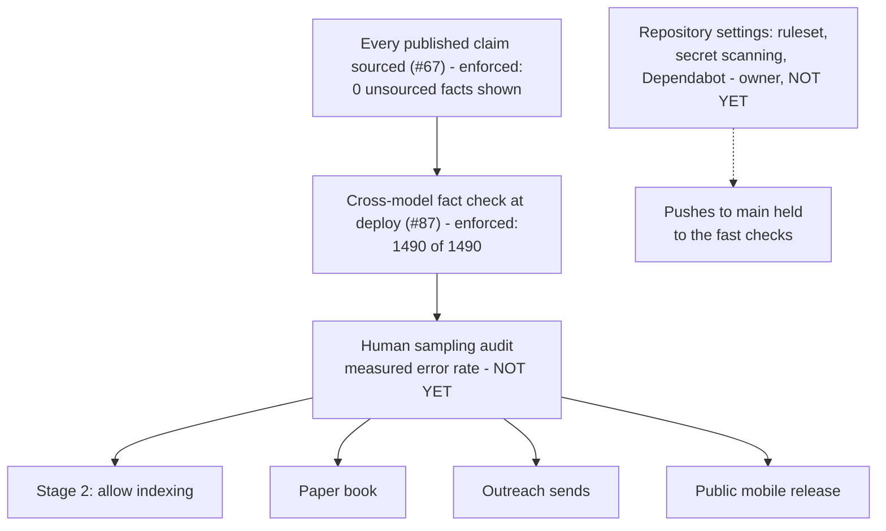

# Progress

Where every workstream stands, in one place. [`CHANGELOG.md`](CHANGELOG.md) records what changed and
when, [`ROADMAP.md`](ROADMAP.md) what is planned, [`DECISIONS.md`](DECISIONS.md) why, [`TODO.md`](TODO.md)
what is open. This file is the status view across them: what is built, what is half-built, what is
blocked and on what. Every number below is the output of the command next to it, run on the date given.

**Status as of 2026-10-13**, on `main` at `fcf0b65`, which production serves (`https://eu27.cloud`, deploy
run 38373353625, every gate job green). Nothing is unpushed in this repository. The private contacts repo
was not opened in this update; its figures below are from 2026-09-24.

---

## At a glance

| Workstream | State | Evidence (2026-10-13) |
|---|---|---|
| Content model + footnoted outputs | **Done** (#74, #75, #82) | `document.py --check`: 27 documents and the EU-27 overview, 0 unsourced facts |
| Cross-model fact check at deploy | **Done**, gate on every push to `main` (#87, #89) | `factcheck status`: 1490 of 1490 printed facts checked, supported, checker ≠ author |
| **Source register** | **1,272 sources, 2,331 citations**: 162/621 params, 1,618/1,933 records, 142/189 indicators, 0/22 assumptions | `python3 model/provenance.py` (#67) |
| **Critical holdings register** | **741 of 1,053 pairs** (70%) recorded, each cell cited; labels reviewed (#79) | `python3 model/national_data.py` (#73) |
| Gaps | 3,671 gaps in 5,625 cells, each with how often it was searched | `python3 model/gaps.py` → `docs/gaps.md` |
| Data-sovereignty ranking | **Evidenced** (#77) | IE Dependent (High); IT Secured in law (Low); 25 Not demonstrated (Low) |
| Hosting of key registers | **Printed and compared** across the EU-27 (#95); operators as entities planned (#96) | `/infrastructure`, `countries/EU-INFRASTRUCTURE.md` |
| Web app | **Live at eu27.cloud**, landing design (#101), guides (#102), one address per state (#105) | 55 Vitest; Playwright 73 (chrome) + 44 × 4 (firefox, webkit, two iPhones), run 38373353625 |
| `/ask` | **Live**, real API call in the gate | deploy step "The live /ask answers through a real API call": success |
| PDFs | **Done**: EU-27 report + 27 country reports, compiled in CI | `Gate / PDFs`: success |
| Per-country artefacts | **Done**, 27 posters, hashes pinned | `countries/ARTEFACTS.csv` (#52) |
| Deployment | **Push to `main` deploys** the gate's own build; records, promotes, rolls back by URL (#81, #97, #107) | run 38373353625: record, promote ran; rollback skipped |
| Repository settings | **NOT YET**: ruleset, secret scanning, Dependabot security updates | three owner commands, `docs/plans/ci-cd-hardening.md` |
| Authored notes | **Four**, each with a checker, never rendered (#59, #103, #104, #108) | `python3 model/notes.py check`: 4 `ok` |
| Language drafts | **Staged**, not rendered; plan written, decision not yet | `i18n_drafts.py check`: 27 states, 1,440 cells, 1,398 ok, 42 fix |
| Institutional map | **25 of 324 pairs** (37 rows), unchanged since 2026-09-24 | `python3 model/institutions.py` |
| Named contacts | 956 rows, 910 people, 850 send-ready, as of 2026-09-24; not re-run | private repo at `contacts/` (#66) |
| Mobile reader | **Stale**: schema-1 bundle, never built or deployed; Jest not run here | `mobile/`; `docs/plans/mobile-app.md` |
| Paper book | **Scaffolded**; not checked in this update | `book/` |
| **Full test gate** | **Green**: 18 stages as parallel CI jobs | `python3 -m unittest discover -s tests`: Ran 379 tests, OK; run 38373353625 |

**The launch gate (#25, #67): nothing launches — indexing, the book, the mobile release, outreach sends —
until a person has measured how often the admitted claims are wrong.** The machine half is enforced: the
site withholds anything unsourced, and every printed fact is checked by a model that did not write it
(#87). The human sampling audit has not been done. The domain itself is live (#90), which the gate once
held back; `ROADMAP.md` § launch gate has the current position.

---

## How the pieces fit

```mermaid
flowchart LR
    subgraph raw[Raw data, in git]
        HC[model/holding_classes.csv<br/>39 classes]
        ND[model/national_data.csv<br/>holdings per state]
        SI[model/sovereignty_indicators.csv<br/>7 indicators per state]
        P[model/eu27_parameters.csv<br/>Eurostat + posture]
        SR[model/sources/<br/>registry + citations]
    end

    RS[model/research/<br/>agent staging] -- "research.py: fetch, sha256,<br/>quote found, review agrees" --> ND
    RS --> SI
    RS --> SR

    subgraph model[Python, stdlib only]
        CD[country_data.build]
        SV[sovereignty.py<br/>groups + confidence]
        DOC[document.py<br/>ONE content model]
    end

    HC --> CD
    ND --> CD
    P --> CD
    SI --> SV
    CD --> DOC
    SV --> DOC
    SR --> DOC

    DOC --> B[web/public/data/eu27.json]
    DOC --> G["countries/&lt;ISO&gt;/GOAL.md"]
    B --> REP[book/report.py<br/>EU-27 report + 27 PDFs]
    B --> WEB["web/ React<br/>eu27.cloud/&lt;iso&gt;"]
    B --> POS[posters]
    B --> ASK[api/_corpus.json<br/>/ask]
    FC["/factcheck ledger<br/>checker ≠ author (#87)"] -. gate .-> WEB
    T[design/tokens.json] -.-> WEB
    T -.-> REP
    N["Authored notes + language drafts<br/>model/notes.py: checked, never rendered"] -.x DOC
```

Every fact in every output is a span of the one content model, and every span that states a fact
carries claim ids that resolve to a checked source (#74, #75). The authored notes and the language
drafts sit outside it: checked by their own contracts, read by nothing that renders.

---

## Done

Each claim below is followed by the command that demonstrates it, run on 2026-10-13 unless dated.

### Evidence, verified and admitted
Research runs across all 27 states, then the waves of 2026-10-06 for the cheapest gaps. Each claim is
admitted only after its document was fetched, hashed and found to contain the quote; every categorical
label also needs an independent reviewer's agreement (#79). The method is in [`METHOD.md`](METHOD.md).

```
$ python3 model/research.py report | tail -1          # exact  loose  not_found  fetch_failed
all          2192           21           75          228            0            0

$ python3 model/national_data.py | grep -E 'pairs|rows'
741/1053 (country, record class) pairs recorded (70%)
741 rows, of which 732 name a register and 9 evidence its absence.

$ python3 model/provenance.py
1272 sources, 2331 citations
namespace     supported  declared   claims
param               162         0      621    26.1% sourced
assumption            0         0       22     0.0% sourced
record             1618         0     1933    83.7% sourced
indicator           142         0      189    75.1% sourced

$ python3 model/gaps.py | tail -1
wrote docs/gaps.md: 3671 gaps in 5625 cells
```

### Every fact shown is sourced, and checked by a second model
```
$ python3 model/document.py --check
27 documents and the EU-27 overview checked, 0 unsourced facts

$ ./run.sh factcheck status | tail -1
1490 of 1490 printed facts checked, supported, checker ≠ author
```
A fact the checker does not confirm is withheld as disputed, not printed (#89); the deploy fails on a
printed fact that is new, changed or checked by its own author (#87).

### The ranking (#77)
```
$ python3 model/sovereignty.py | grep -E '^(IE|IT) '
IE  Dependent on non-EU providers              High
IT  Secured in law, not yet in practice        Low
$ python3 model/sovereignty.py | grep -c 'Not demonstrated'
25
```
The 25 are Low mainly because hosting is unpublished for most holdings (`ROADMAP.md` § raise confidence).
The ranking has no score, by test (#10, #77).

### The outputs, live
- **Web app** at `https://eu27.cloud`: the landing design (#101), a guide page behind every selector
  button (#102), each member state at its code (`/de`, `/el`; #105), the hosting overview (#95), Sources,
  Ask, Methodology with its graphics (#88).
- **PDFs.** The EU-27 report and 27 country reports, typst, compiled and inspected in CI.
- **Posters.** 27, in `countries/<ISO>/`, hashes pinned to the bundle.
- **`/ask`.** Live since 2026-10-03; the gate asks it one real question on every deploy.

```
$ curl -sI https://eu27.cloud/de | head -1
HTTP/2 200
$ curl -sI https://eu27.cloud/country/DE | grep -iE '^HTTP|^location'
HTTP/2 308
location: /DE
```

### Deployment (#81, #97, #107)
A push to `main` runs `./test.sh` as parallel Actions jobs, then ships the gate's own build prebuilt;
the deploy records the current production deployment, smoke-tests the live domain and `/ask`, promotes
the deployment that passed, and rolls back by URL if a post-deploy check fails. The rollback step has
never fired. The assistant may push to `main` under a tracked permission rule, with the owner's OK in
the conversation first (#106).

```
$ gh run view 38373353625 --json jobs --jq '.jobs[] | "\(.name): \(.conclusion)"'
Gate / PDFs (./test.sh --only pdf): success
Gate / Model and data (./test.sh --only model): success
Gate / Web app (./test.sh --only web): success
Gate / Browser tests (iphone-17-pro): success      # and webkit, chrome, iphone-se, firefox
Build and deploy to production: success
  Record the current production deployment: success
  The deployment that passed is the current production deployment: success
  Roll back to the previous production deployment: skipped
```

**NOT YET applied**, because they are repository settings the assistant's own rule denies: the ruleset on
`main` (no force push, no deletion, four required fast checks), secret scanning with push protection, and
Dependabot security updates. The three commands are in `docs/plans/ci-cd-hardening.md`.

### The test gate
Eighteen stages (`docs/testing.md`), the same locally and in CI: Python, the sourcing gate, the authored
notes and drafts through one register, generated files current, the API type-check, lint, types, Vitest,
build, the PDFs, Playwright with axe on every project, visual regression on the macOS baselines, the live
`/ask`.

```
$ python3 -m unittest discover -s tests 2>&1 | tail -2
Ran 379 tests in 15.433s
OK
$ cd web && npx vitest run 2>&1 | grep Tests
      Tests  55 passed (55)
$ python3 model/notes.py check
  ok   the national-AI note (#103): 27 states, 467 URLs (462 answered at the last link check), 175 unverified marks, 38,429 words, 0 problems
  ok   the sovereign-appliance note (#104): 13 sections, 8 URLs (7 answered at the last link check), 4 unverified marks, 4,165 words, 0 problems
  ok   the language drafts (docs/plans/localisation-plan.md): 27 states, 45 keys, 1440 cells, 27 reviewed, 1398 ok, 42 fix, 0 problems
  ok   the technical-universities note: 27 states, 61 rows (C1 44, C2 3, C3 11, [unverified] 1, none 2), 73 URLs (67 answered at the last link check), 0 problems
```
Playwright on run 38373353625: chrome 73 passed; firefox, webkit, iphone-se and iphone-17-pro 44 passed each.

### The authored notes (#59, #103, #104, #108)
Four notes at the root that the model never reads: the feasibility ranking, the national AI strategies, the
sovereign appliance, the technical universities. Each from #103 on has a checker, a committed link
register, and a test that fails if any renderer names it; all run through `model/notes.py` in one gate
stage. The universities note was checked row by row by a second agent on the same model and then by a
`claude-fable-5-1` agent (zero discrepancies); the appliance note's quotations have had no second-model
review. **No person has read any of the three recent notes.**

### Language drafts (staging)
`docs/i18n/drafts/<ISO>.md`, 27 files: the app's 45 chrome strings in every official language of the state,
drafted by two agents on two models, each reviewing the other's every cell. BCP 47 tags and Unicode NFC
enforced. Nothing renders them; the plan to serve them at `/<iso>/<lang>` is `docs/plans/localisation-plan.md`
and its decision entry is not yet written.

### Security and privacy
- Every commit and push passes `dotfiles/security/gate.sh`; gitleaks and the gate run in CI over full history.
- `tests/test_ignore_rules.py` asserts the rules that keep personal data out of git and off Vercel.
- `tests/test_permissions.py` holds the shape of the assistant's permission rule: exact pushes only, every
  other outward action denied by name (#106).
- The `/ask` keys exposed on 2026-10-06 were revoked the same day; the finding is closed.
- Named individuals live only in the private repo checked out at `contacts/` (#26, #45, #46, #49).

### Kept for the record
- The capacity model is withdrawn, not sized; the engine is kept for sizing from measured holdings (#73).
- The Dutch-scaled figures, the sovereignty matrix, the heatmap, the scenario sandbox and the Chrome
  briefing PDFs were withdrawn by #72 to #76.
- The gate was red for a week in September 2026 because CI ran only the Python suite; since #92 and #97
  CI runs every stage, so a red `./test.sh` cannot ship.

---

## In progress

### The institutional map — 25 of 324, unchanged since 2026-09-24
`model/institutions.csv` holds 37 admitted rows after a validator screen in the private repo; the email-routed
bodies sit there until each one's contact *page* is found (#68).
```
$ python3 model/institutions.py | tail -2
25/324 (country, function) pairs filled (8%)
37 rows, of which 9 are EU-level (tier 0).
```

### Named contacts — as of 2026-09-24, not re-run
The private repo at `contacts/` held 956 seats, 910 people, 850 send-ready rows (#66). Nothing in it was
opened for this update; the figures are the last ones run. Counts only here; no name crosses into this
repository.

### Localisation
Stage 1 of `docs/plans/localisation-plan.md`: apply the 42 `fix` cells, get a native reading per language, then
write the decision entry. Not started.

### The mobile reader
`mobile/` is an Expo app on the withdrawn schema-1 bundle, never built or deployed, with four Dependabot
alerts in its lockfile. Port it to the content model or drop it; the owner's call (`TODO.md`).

---

## What gates what



The machine checks are built and enforced. What gates launch now is a person measuring how often the
admitted claims are wrong; what gates the pipeline's last hardening is three commands only the owner runs.

---

## Next

1. **Owner:** the three repository-settings commands (`docs/plans/ci-cd-hardening.md`); push `dotfiles`
   `893d744`; read `TECHNICAL-UNIVERSITIES.md` and a language draft; reset the local `sovereign-appliance`
   branch to `main`. All in `TODO.md` § Publish.
2. **Print `eu27.cloud/<iso>`** on the country PDFs and posters: a `label` span, a changelog entry, `/factcheck`.
3. **Raise confidence** (`ROADMAP.md` § raise confidence): a hosting research pass with #79 review; a decision on
   classified holdings; a rendering fetch for JavaScript pages; re-run AT, BE and EE; record counts and sizes.
4. **The human sampling audit,** which gates launch.
5. **Localisation stage 1**, then its decision entry.
6. **Mobile to schema 2,** and the book's country parts from the content model.

---

## Maintaining this file

Update it in the same session as the work it describes. Every status line needs a command and its
real output, not a statement — if a number here cannot be reproduced by running something, it does
not belong; say the date it was run, and say when a figure was not re-run. `tests/test_docs.py` checks
that every `#N` decision reference in this file resolves.
