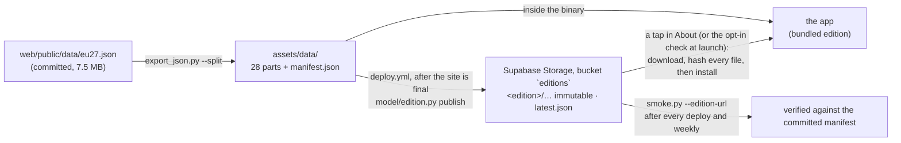

# `mobile/` — the reader

A phone reader of the EU-27 report: one app, with the member state as data rather than as a build flavour.
It ships the fact-checked content model inside its binary, split per state, and reads it with no network at
all. It learns of a newer edition from one public, read-only bucket, verifies every file against its
published hash before showing a single value from it, and otherwise keeps the edition it has (DECISIONS.md
#109 to #113).

**No release yet.** No build, no store listing, no EAS. `vercel.json` builds `web/` and `.vercelignore`
excludes this directory, so nothing here ships anywhere. A public release is gated on the same verification
work as search indexing and the `eu27.cloud` domain (`DECISIONS.md` #25, #50).

```bash
./init.sh                 # Node and npm checked, npm ci, the 28 parts generated, an .env.local you may leave empty
./run.sh web              # or ios / android / start / prod / debug
./test.sh                 # every check below; exit 0 = green
./test.sh --quick         # the developer loop: static checks and unit tests
./init.sh --supabase      # also start the local Supabase stack (Colima), then:
./test.sh --integration   # the edition channel end to end against it
```

The root gate runs the same suite as its `mobile` group (`./test.sh --only mobile`), and CI as a parallel job
(`.github/workflows/gate.yml`). Use Node 24 (`.nvmrc`); on a machine where another `node` shadows nvm, put
`~/.nvm/versions/node/v24.*/bin` first on the `PATH`.

## The edition

`model/export_json.py --split` writes the committed bundle `web/public/data/eu27.json` as 28 parts into
`assets/data/`: `eu27.core.json` (everything that is not one state's: the notice, the ranking, the
methodology, the infrastructure overview, the EU fact-check appendix, and an index of the 27 for the country
list) and one `eu27.<ISO>.json` per state (its document, data, fact-check appendix and exactly the claims and
sources its spans cite), with a `manifest.json` naming the sha256 of every part and of the single file: the
**edition id**. The parts are a pure function of the single file, so they are generated, never tracked;
`tests/test_export_split.py` proves they merge back to it byte for byte. The manifest is tracked here and at
`web/public/data/manifest.json`, so the site publishes its edition id too.



| Object in the bucket                                                               | Written                                     | Cached   |
| ---------------------------------------------------------------------------------- | ------------------------------------------- | -------- |
| `<edition>/manifest.json`, `<edition>/eu27.core.json`, `<edition>/eu27.<ISO>.json` | once, never overwritten (`x-upsert: false`) | a year   |
| `<edition>/published.json` (commit, run, time)                                     | once                                        | a year   |
| `latest.json` (the edition the deploy last published)                              | on every deploy                             | a minute |

**On the device** (`src/edition/EditionStore.ts`): the app renders the bundled edition unless a downloaded
one was installed and verified. A downloaded part is hashed on every read, before it is parsed; a mismatch
discards that edition, falls back to the bundled one and names the part on the About screen. A check for a
newer edition downloads `latest.json`, then the manifest (which must hash to what `latest.json` says) and
every part (which must hash to its manifest entry) into a temporary directory; any failure leaves nothing
behind. The hash chain proves integrity, not authorship: until a signed manifest exists, the Supabase project
is a trusted party (#111).

## Screens

| Route                              | What it is                                                                                 |
| ---------------------------------- | ------------------------------------------------------------------------------------------ |
| `app/(tabs)/index.tsx`             | The 27 member states, filterable, with each one's evidence counts from the edition's index |
| `app/country/[iso].tsx`            | One state's report: the content model, section by section, then its numbered sources       |
| `app/(tabs)/infrastructure.tsx`    | Key infrastructure and hosting across the 27 (#95), from the generated overview            |
| `app/(tabs)/sovereignty.tsx`       | The ranking by published rule (#77): groups, each state's range as a bar, no score         |
| `app/(tabs)/method.tsx`            | The methodology, from the generated document                                               |
| `app/fact-check/{index,[iso]}.tsx` | How every printed fact was checked by the model that did not write it (#87)                |
| `app/(tabs)/about.tsx`             | This edition: id, date, source, counts, the notice, and the check for a newer edition      |

`src/components/DocumentView.tsx` is the renderer, ported from `web/src/components/DocumentView.tsx`: a fact
carries its `[n]` source marks, a gap is muted italics, a disputed value muted italics with a dashed
underline, a table is stacked into cards. Nothing here adds a sentence; `__tests__/document-view.test.tsx`
checks that the text on screen is the spans' text. Every screen ends with the provenance notice, in the
edition's own words (`tests/test_evidence.py`).

Colours and the type scale are `src/constants/Colors.ts`, generated by `design/build_tokens.py` from
`design/tokens.json`; light and dark both come from there. Fonts are the system's in this cut.

## The parity contract

Three files under `src/data/` are copies of files in `web/`, pinned byte for byte below their header comment
by `__tests__/parity.test.ts`: `types.ts` (from `web/src/data/types.ts`), `format.ts` (from
`web/src/utils/format.ts`) and `sources.ts` (from `web/src/data/sources.ts`). Editing a web file means
copying it here in the same commit. The same test pins the bundled edition to the committed bundle and the
two tracked manifests to each other. `./run.sh data` at the root regenerates everything, including the parts.

## Test suite (`./test.sh`)

| Step                           | What it checks                                                                                                                                |
| ------------------------------ | --------------------------------------------------------------------------------------------------------------------------------------------- |
| `node`, `deps`                 | Node ≥ 20.19.4 (24 expected); `node_modules` matches the lockfile                                                                             |
| `secrets`                      | no tracked `.env*` but `.env.template`                                                                                                        |
| `shell`                        | every script parses under bash and `/bin/bash` 3.2; shellcheck when installed                                                                 |
| `tooling`                      | the CLI the deploy's gate installs is an exact version, Supabase CLI 2.120.0, and the one named here; no EAS anywhere                         |
| `pins`                         | every dependency is an exact `x.y.z`                                                                                                          |
| `identity`                     | `app.json`, `package.json` and `supabase/config.toml` name this project, not the template                                                     |
| `env-keys`                     | every `EXPO_PUBLIC_*` the code reads is declared in `.env.template` (names only)                                                              |
| `scripts`                      | `run.sh help`, `init.sh --help`, `test.sh --help` exit 0; unknown input exits non-zero                                                        |
| `format`, `lint`, `types`      | Prettier, ESLint (`expo lint`), `tsc --noEmit`                                                                                                |
| `parts`, `edition`, `tokens`   | the 28 parts regenerated; they match the manifest, the manifest the committed bundle, the site's copy the app's; the generated tokens current |
| `unit`, `parity`               | Jest with coverage floors (`jest.config.js`); the parity and security suites named on their own                                               |
| `doctor`, `web-build`, `audit` | expo-doctor; `expo export --platform web`; npm audit against `audit-allowlist.json`                                                           |
| `gate`                         | the workspace security gate over the tree (skipped with `--ci`)                                                                               |
| `integration`                  | with `--integration`: `scripts/integration-test.mjs` against the local stack, nine steps (below)                                              |

The integration run, in order: the deploy's own publisher (`model/edition.py publish`) fills the bucket with
a fixture edition; every object is readable anonymously and hashes to its manifest entry; anonymous writes
and deletes are refused; a re-run changes nothing; `verify` passes; the app's store installs that edition; an
object altered in the bucket with the service key is caught by `verify` by name and rejected by the app,
which keeps the edition it has; the bucket is left empty. Keys come from `supabase status -o env` inside the
process and are never written or printed.

## Security and privacy

The app has no accounts, no analytics, no telemetry and no crash reporting. It collects nothing, and in its
default configuration makes no network request at all. `__tests__/security.test.ts` asserts each of these:

- **No capabilities.** `android.permissions` is empty, `ios.infoPlist` declares no usage strings, and
  nothing re-enables cleartext traffic (Android refuses it by default).
- **No publishable secrets.** Expo inlines every `EXPO_PUBLIC_*` variable into the shipped JavaScript, so only
  the Supabase URL and anon key may ever be named there. The anon key unlocks nothing: the bucket's one policy
  is a public `select` (`supabase/migrations/`), and only the service role, held by the deploy workflow,
  writes. Secret-shaped names fail the test, and `.env.template` ships no values.
- **A dependency allowlist**, not a denylist, and exact pins: analytics and ad SDKs arrive under names nobody
  predicts.
- **One network path.** Downloads happen only in `src/edition/expoFiles.ts`; URLs are built only in
  `src/services/channel.ts`, from the configured project; no file hardcodes a host; external links open only
  from a source entry or a submission form.
- **Nothing persisted about the reader.** No session storage dependency. On the device: the downloaded
  edition, a pointer to it, and one setting (whether to check automatically at launch, off by default).

**What one check sends, and to whom.** A tap on "Check for a newer edition" (or launch, if the reader has
switched the automatic check on) sends one request for a 200-byte pointer to the project's Supabase Storage,
and up to 29 more for the files of a newer edition. Supabase, and the cloud provider its EU-region project
runs on, see the reader's network address, the app's user agent and the time, in their request logs, as any
host does. Nothing identifies the reader; nothing about the reader is stored; no request is made unless the
reader asks. `docs/plans/stichting.md` § Privacy records Supabase among the processors for this reason.

`__tests__/parity.test.ts` additionally asserts the edition names no individual: the institutional map is
public; named people live in the separate private contacts repo (`DECISIONS.md` #26, #49), and the app is
exactly where such a leak would ship.

## Supabase

`src/services/supabase.ts` builds a client only when `EXPO_PUBLIC_SUPABASE_URL` and the anon key are set;
unconfigured means `null`, and the app then reads its bundled edition and makes no request. Auth is off; there
are no sessions to persist. The local stack (`supabase/config.toml`, project id
`eu27-data-sovereignty-mobile`) exists for `./test.sh --integration`; the hosted project is the owner's
(`DEPLOYMENT.md` § The edition channel).
